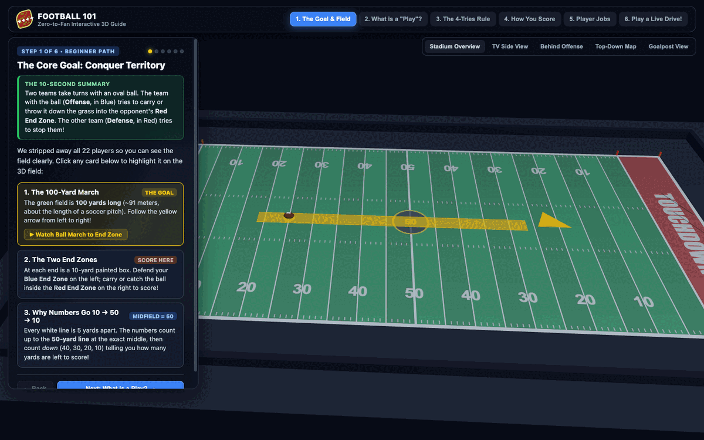
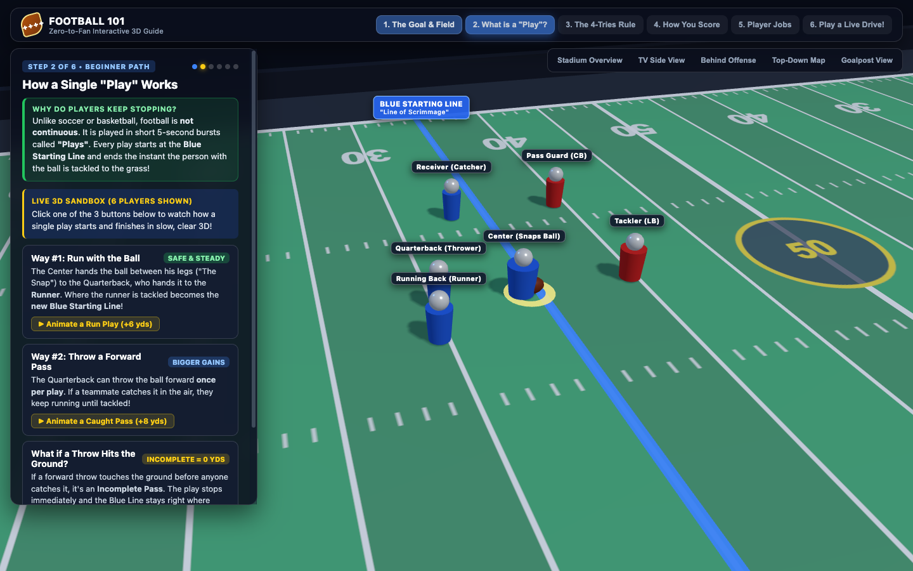
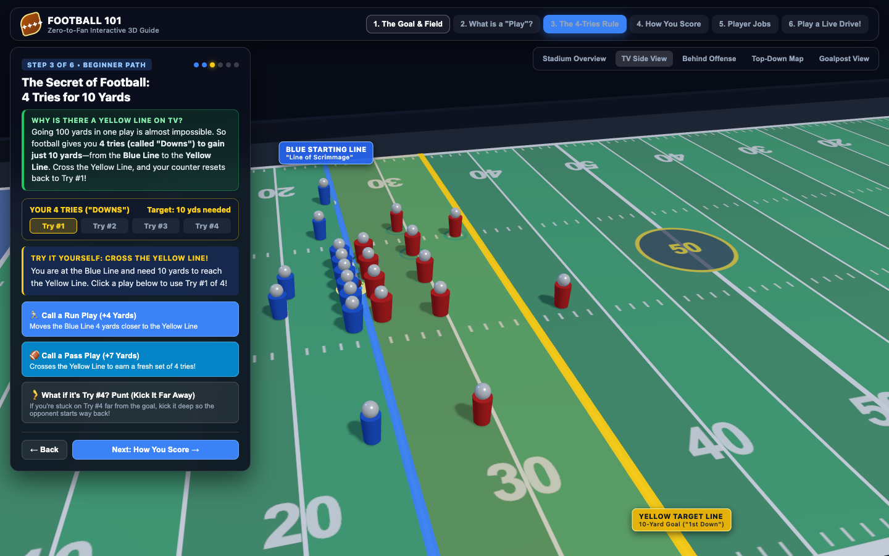
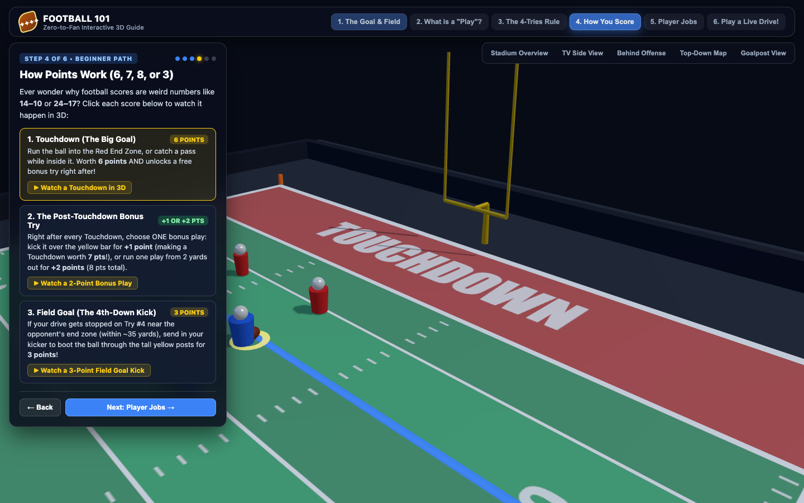
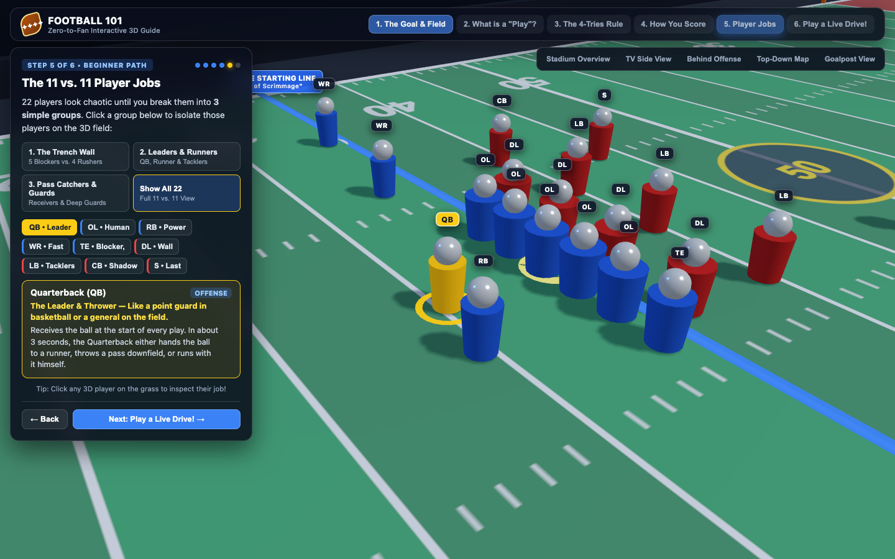
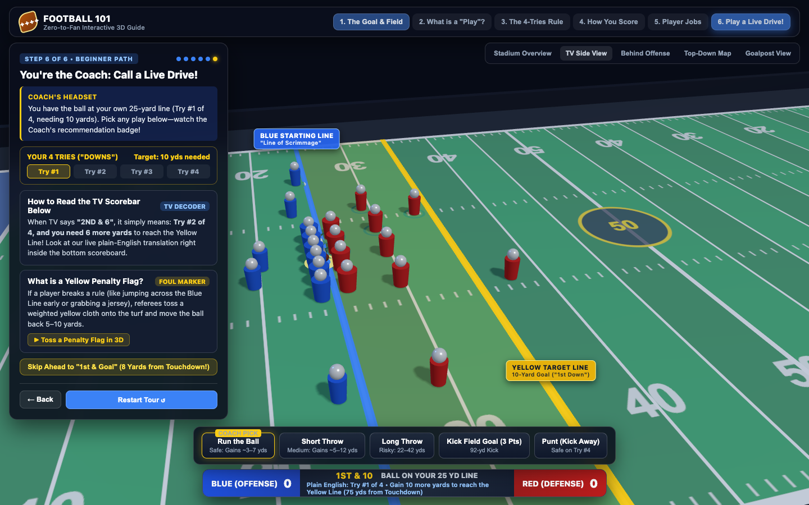

# Football 101 — Interactive 3D Guide to American Football

An interactive, single-file 3D web application built with **Three.js** designed to teach someone with zero background in American Football everything they need to know to understand and appreciate the game.

## Prompt & Generation

Created using **Gemini 4 Carbon** in **less than 2 minutes** with a single prompt:

> *"Build a 3D interactive model to teach someone who does not know American Football everything they need to know to appreciate the game."*

---

## Animated Demo (GIF)



---

## Screenshots

### Step 1: The Goal & Field (Zero-Clutter Empty Field)


### Step 2: How a Single "Play" Works (6-Player Sandbox)


### Step 3: The Secret of Football — 4 Tries ("Downs") for 10 Yards


### Step 4: How Points Work (6, 7, 8, or 3)


### Step 5: The 11 vs. 11 Player Jobs (3 Simple Layers)


### Step 6: Live Drive Simulator with Plain-English TV Scorebar Decoder


---

## Progressive 6-Step Beginner Journey

Instead of overwhelming newcomers with 22 players and broadcast jargon all at once, the 3D scene progressively adds concepts one layer at a time:

1. **The Goal & Field (Empty Field)**: Strips away all players and lines to show the 100-yard grass field, why yard numbers count `10 → 50 → 10`, the two End Zones, and a 1-click animation of the ball marching into the opponent's End Zone.
2. **What is a "Play"? (6-Player Sandbox)**: Explains why football happens in short 5-second bursts starting from the **Blue Starting Line** (*Line of Scrimmage*), with 1-click 3D animations for a **Run Play**, a **Caught Pass**, and an **Incomplete Pass**.
3. **The 4-Tries Rule (Blue Line → Yellow Line)**: Introduces the **Yellow Target Line** 10 yards ahead and a visual 4-Tries ("Downs") tracker so you can step through plays and see how crossing the Yellow Line resets the counter back to Try #1.
4. **How You Score (Live 3D Scoring Demos)**: Explains why scores are multiples of 3, 6, 7, and 8 with live 3D animations for a **Touchdown (6 pts)**, **Extra Point / 2-Point Bonus Try (+1 or +2 pts)**, and **Field Goal (3 pts)**.
5. **Player Jobs (3 Simple Layers)**: Breaks the 22 players into 3 digestible groups (*The Trench Wall*, *Leaders & Runners*, and *Pass Catchers & Guards*) with plain-English analogies.
6. **Play a Live Drive! (With TV Scorebar Decoder)**: Unlocks the full 11-vs-11 play-calling simulator, Coach Recommendations, 3D Yellow Penalty Flags, and a live plain-English translator inside the TV scorebug (translating `"1ST & 10"` into `"Plain English: Try #1 of 4 • Gain 10 more yards to reach the Yellow Line"`).

## How to Run

No build tools or installations are required. Simply open [`football-101.html`](football-101.html) in any modern web browser:

```bash
open football-101.html
```
